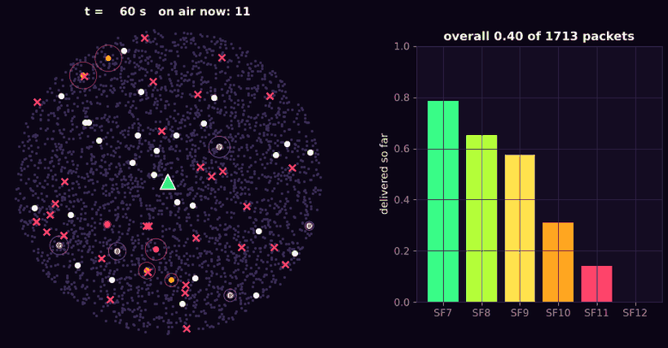
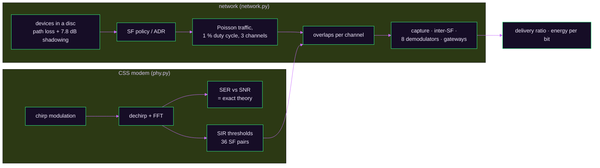
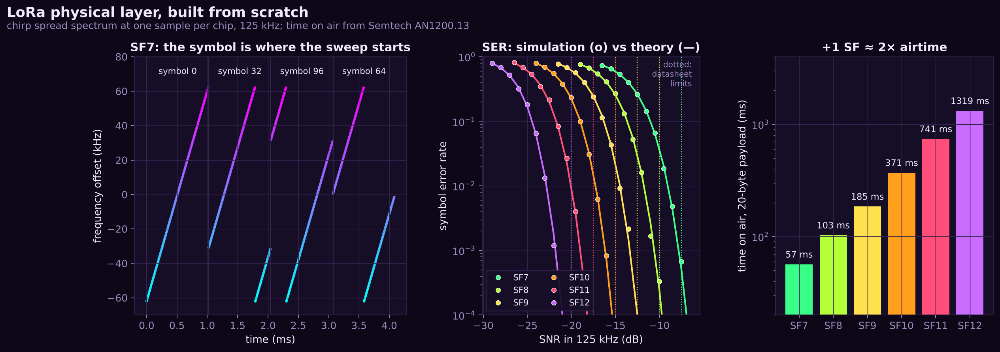
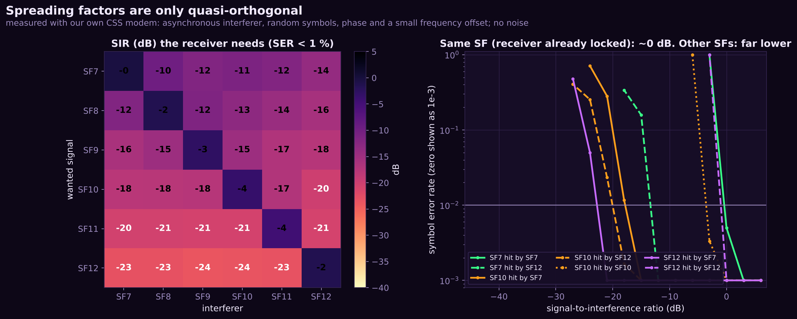
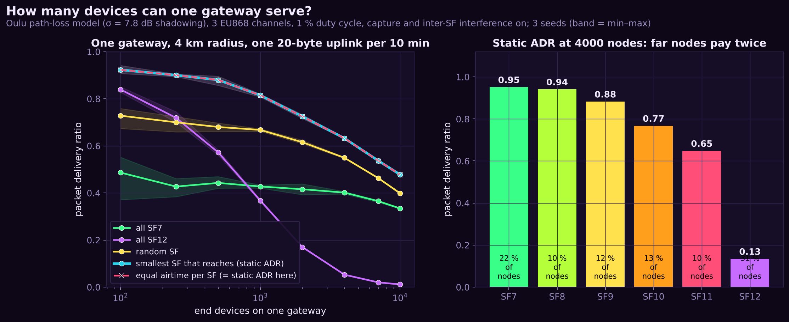
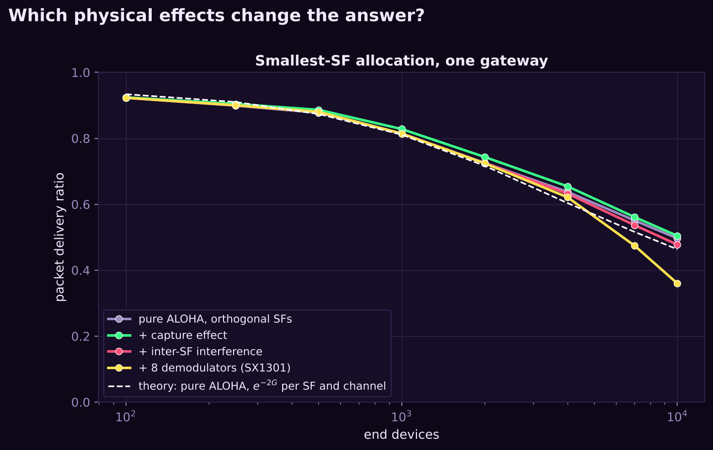
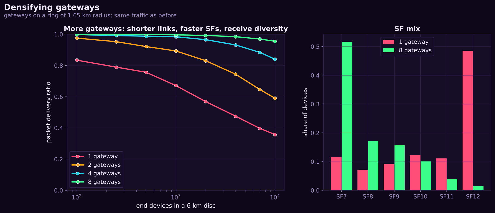
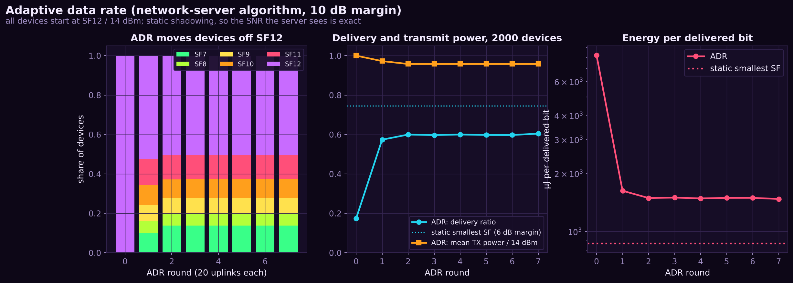

<p align="center"></p>

<p align="center">


</p>

<h3 align="center">LoRa reaches kilometres on a coin cell, but every device shares the same few channels<br>with no coordination at all. How many sensors can one gateway really serve?</h3>

**LoRaWAN** is the radio behind millions of meters, trackers and farm sensors. A device wakes up, sends a few bytes on one of three channels whenever it likes (pure ALOHA), and goes back to sleep. Range comes from **chirp spread spectrum**: the higher the spreading factor (SF7 to SF12), the further the signal reaches, and the longer it occupies the channel. Every SF step doubles the airtime, and with it the chance of a collision.

This repository answers the scaling question from the bottom up:

1. **A LoRa modem built from scratch** (chirp modulation, dechirp + FFT demodulation), checked against the exact error-rate theory.
2. **The interference between spreading factors measured with that modem**, instead of assuming SFs are orthogonal.
3. **A discrete-event LoRaWAN simulator** with path loss and shadowing, duty cycle, capture, inter-SF interference, the gateway's 8 demodulators, several gateways, and the network-server ADR algorithm.
4. **Energy per delivered bit** and battery life.

<table>
<tr>
<td align="center" width="25%"><h2>−10 to −24 dB</h2><sub>a different SF is rejected even<br>when it is up to 240× stronger<br>(measured, 30 SF pairs)</sub></td>
<td align="center" width="25%"><h2>0.81 → 0.48</h2><sub>delivery ratio of one gateway<br>with 1 000 and 10 000 devices<br>(one uplink per 10 min)</sub></td>
<td align="center" width="25%"><h2>1.2 %</h2><sub>delivered when all 10 000 devices<br>use SF12 "to be safe":<br>the channel is 7× overloaded</sub></td>
<td align="center" width="25%"><h2>0.36 → 0.96</h2><sub>delivery for 10 000 devices<br>in a 6 km disc with 1 and<br>with 8 gateways</sub></td>
</tr>
</table>

<p align="center"></p>
<p align="center"><sub>Two minutes of a 3000-device cell with one uplink every 2 minutes (a stress test), sped up. Rings grow with time on air; white: delivered, red ×: lost. Right: delivery ratio per SF so far. SF12 packets last 1.3 s and almost never survive.</sub></p>

---

## ◈ Run it

```bash
pip install numpy scipy matplotlib
python experiments/run_all.py            # everything, about 25 min on one core
python experiments/run_all.py phy        # or one experiment
python experiments/make_gif.py           # the animation frames
python -m pytest tests                   # 7 tests
```

Everything is seeded; every figure's numbers are in [`results/`](results).



## ◈ 1 · The physical layer, from scratch

<p align="center"></p>

A LoRa symbol is an up-chirp that sweeps the 125 kHz band in $2^{SF}$ chips; the data is the frequency where the sweep starts. The receiver multiplies by a down-chirp and takes an FFT: the start frequency becomes a single tone ([`phy.py`](lorasim/phy.py)). That makes LoRa non-coherent $M$-ary orthogonal signalling with $M = 2^{SF}$, whose exact error rate is

$$P_s = 1 - \int_0^\infty 2r\,e^{-(r^2+E_s)}\,I_0\!\left(2r\sqrt{E_s}\right)\left(1-e^{-r^2}\right)^{M-1}dr,\qquad E_s = 2^{SF}\cdot\mathrm{SNR}.$$

Simulation (dots, up to 6000 symbols per point) and theory (lines) agree for all six SFs. The theory puts SER = 10⁻³ at **−7.8 dB for SF7 and −21.8 dB for SF12**, 0.3–1.8 dB below the SX1276 datasheet demodulation limits (−7.5 … −20 dB, dotted): the datasheet keeps some margin. Each SF step costs about 2.5 dB of SNR and doubles the time on air (Semtech AN1200.13 formula, checked in the tests against the Semtech calculator):

| SF | 7 | 8 | 9 | 10 | 11 | 12 |
|:--|--:|--:|--:|--:|--:|--:|
| time on air, 20-byte payload | 56.6 ms | 102.9 ms | 185.3 ms | 370.7 ms | 741.4 ms | 1318.9 ms |
| sensitivity (SX1276, 125 kHz) | −123 dBm | −126 | −129 | −132 | −134.5 | −137 |

## ◈ 2 · Spreading factors are not orthogonal

<p align="center"></p>

Simulators often treat different SFs as perfectly orthogonal. They are not: a strong enough SF7 packet will wipe out an SF12 one. The modem measures, for each of the 36 pairs, the signal-to-interference ratio below which the symbol error rate exceeds 1 %. The interferer is asynchronous, carries random symbols, and has a random phase and a small carrier offset ([`ser_with_interferer`](lorasim/phy.py)).

* **Different SFs:** −9.8 dB (SF7 vs SF8) down to −23.8 dB (SF12 vs SF9). The higher the wanted SF, the more processing gain it has, and the stronger the interferer it tolerates.
* **Same SF:** the wanted packet survives at about **−0.4 to −4.5 dB**, but only because the receiver here is already locked to it. A real gateway must first catch the right preamble. The network simulator therefore uses the **6 dB co-SF capture threshold** measured on hardware by Bor *et al.* (2016) on the diagonal, and the measured inter-SF values elsewhere.

## ◈ 3 · How many devices per gateway

<p align="center"></p>

One gateway in a 4 km disc; every device sends 20 bytes every 10 minutes on average; propagation follows the LoRa measurements of Petäjäjärvi *et al.* (Oulu, 2015): $PL = 128.95 + 23.2\log_{10}(d/1\,\mathrm{km})$ with 7.8 dB shadowing. 3 seeds × 2 simulated hours per point.

| Devices | 100 | 1 000 | 4 000 | 10 000 |
|:--|--:|--:|--:|--:|
| smallest SF that reaches (6 dB margin) | **0.92** | **0.81** | **0.63** | **0.48** |
| random SF | 0.73 | 0.67 | 0.55 | 0.40 |
| all SF7 | 0.49 | 0.43 | 0.40 | 0.33 |
| all SF12 | 0.84 | 0.37 | 0.05 | 0.01 |
| channel load, smallest SF (Erlang per channel) | 0.03 | 0.34 | 1.34 | 3.35 |

* **All SF7** fails from the start: 55 % of the devices are simply out of its range.
* **All SF12** reaches nearly everyone, but its 1.3 s packets saturate the channel: it is the best choice for 100 devices and by far the worst for 1000 and more.
* **The smallest SF that reaches** (what a converged ADR aims for) is best at every size. About 7 % of devices are out of range even at SF12 because of the 7.8 dB shadowing, so 0.93 is the ceiling.
* An "equal airtime per SF" allocation (in the spirit of EXPLoRa-AT) collapses to the same allocation here: at 4 km, range alone already forces the SF mix.
* Far devices pay twice: at 4000 devices, SF7 devices get 95 % through and the 31 % of devices on SF12 only 13 %.

## ◈ 4 · Which physical effects change the answer

<p align="center"></p>

| Model | 1 000 devices | 4 000 | 7 000 | 10 000 |
|:--|--:|--:|--:|--:|
| pure ALOHA, orthogonal SFs (theory $e^{-2G}$) | 0.815 (0.811) | 0.638 (0.604) | 0.551 (0.516) | 0.497 (0.463) |
| + capture (6 dB) | 0.828 | 0.654 | 0.561 | 0.504 |
| + inter-SF interference | 0.815 | 0.632 | 0.537 | 0.478 |
| **+ 8 demodulators (SX1301)** | 0.815 | 0.621 | **0.474** | **0.360** |

The pure-ALOHA simulation sits on the textbook $e^{-2G}$ curve (slightly above it at high load, because the duty-cycle limit makes the traffic less bursty than Poisson). That checks the simulator. Capture helps by about 1.5 points and inter-SF interference costs 2 to 3. **The real bottleneck at scale is the gateway itself**: an SX1301-class gateway can demodulate only 8 packets at once, and at 10 000 devices that alone removes a quarter of the delivered packets (0.478 → 0.360).

## ◈ 5 · More gateways

<p align="center"></p>

The area grows to a 6 km disc, so one gateway now leaves half of the devices on SF12. Extra gateways are placed on a ring of 1.65 km radius; every device picks the smallest SF that reaches its nearest gateway, and a packet counts if any gateway receives it.

| Devices in a 6 km disc | 100 | 1 000 | 4 000 | 10 000 |
|:--|--:|--:|--:|--:|
| 1 gateway | 0.83 | 0.67 | 0.48 | 0.36 |
| 2 gateways | 0.98 | 0.89 | 0.74 | 0.59 |
| 4 gateways | 1.00 | 0.98 | 0.93 | 0.84 |
| **8 gateways** | 1.00 | 1.00 | **0.99** | **0.96** |

More gateways help twice. Links get shorter, so devices drop to fast SFs: SF12 falls from **49 % of devices to 1 %** and SF7 rises from 12 % to 52 %. And a packet lost at one gateway can still reach another (receive diversity). Densifying gateways is a far stronger lever than any SF allocation trick.

## ◈ 6 · Adaptive data rate and energy

<p align="center"></p>

2000 devices start at SF12 and 14 dBm. After every 20 uplinks the network server runs the standard ADR rule: margin = SNR<sub>max</sub> − SNR<sub>limit</sub>(SF) − 10 dB, one SF step (then 3 dB of power) per 3 dB of margin ([`adr.py`](lorasim/adr.py)).

* ADR converges in **one round**: delivery jumps from 0.17 to 0.57 and settles at **0.60**, and energy per delivered bit drops from 8.2 mJ to **1.49 mJ**.
* It does not reach the static allocation with a 6 dB margin (**0.75 delivered, 0.87 mJ/bit**). The 10 dB ADR margin is built for fading channels; with static shadowing it leaves half of the devices on SF12, and that airtime causes collisions for everyone.
* Transmit power barely moves (mean 13.4 dBm, 1818 of 2000 devices stay at 14 dBm): almost every device needs its margin for the SF, not for power.

Battery life on 2400 mAh with one uplink every 10 minutes (no self-discharge, sleep at 1.5 µA):

| | SF7 | SF8 | SF9 | SF10 | SF11 | SF12 |
|:--|--:|--:|--:|--:|--:|--:|
| at 14 dBm | 27.8 y | 19.9 y | 13.2 y | 7.5 y | 4.1 y | **2.3 y** |
| at 2 dBm | 42.2 y | 35.9 y | 28.2 y | 19.2 y | 11.7 y | 7.2 y |

A device stuck on SF12 needs a new battery 12 times more often than one on SF7. In practice, battery self-discharge caps the low-SF figures at roughly 10 years.

## ◈ What is simplified

* One uplink type (20 bytes, unconfirmed), no downlinks: acknowledgements and downlink duty cycle would load the gateway further.
* Static shadowing per device, no fast fading; ADR therefore sees exact SNRs.
* The capture model compares powers over the whole packet overlap; it does not model timing (a stronger packet arriving after the preamble lock of a weaker one).
* Energy uses a PA-efficiency model calibrated on one SX1276 datasheet point (87 mA at +17 dBm), not a measured board.

## ◈ Repository map

```
lorawan-scalability-sim/
├── lorasim/
│   ├── phy.py         CSS modulation, demodulation, SER theory, SIR measurement, time on air
│   ├── network.py     discrete-event LoRaWAN uplink simulator
│   ├── adr.py         network-server ADR loop
│   └── energy.py      energy per uplink, battery life
├── experiments/
│   ├── run_all.py     every experiment and figure
│   ├── make_gif.py    the network animation
│   └── style.py
├── tests/             7 tests
├── figures/  results/  assets/
```

## ◈ References

1. M. Bor, U. Roedig, T. Voigt, J. M. Alonso, "Do LoRa low-power wide-area networks scale?" *Proc. ACM MSWiM*, 2016.
2. J. Petäjäjärvi, K. Mikhaylov, A. Roivainen, T. Hänninen, M. Pettissalo, "On the coverage of LPWANs: range evaluation and channel attenuation model for LoRa technology," *ITST*, 2015.
3. D. Croce, M. Gucciardo, S. Mangione, G. Santaromita, I. Tinnirello, "Impact of LoRa imperfect orthogonality: analysis of link-level performance," *IEEE Commun. Letters*, vol. 22, no. 4, 2018.
4. T. Elshabrawy, J. Robert, "Closed-form approximation of LoRa modulation BER performance," *IEEE Commun. Letters*, vol. 22, no. 9, 2018.
5. F. Cuomo *et al.*, "EXPLoRa: Extending the performance of LoRa by suitable spreading factor allocations," *IEEE WiMob*, 2017.
6. Semtech, *SX1276/77/78/79 datasheet* and *AN1200.13 LoRa modem designer's guide*.

## ◈ Licence

MIT © Eng. Jaafar Salim
